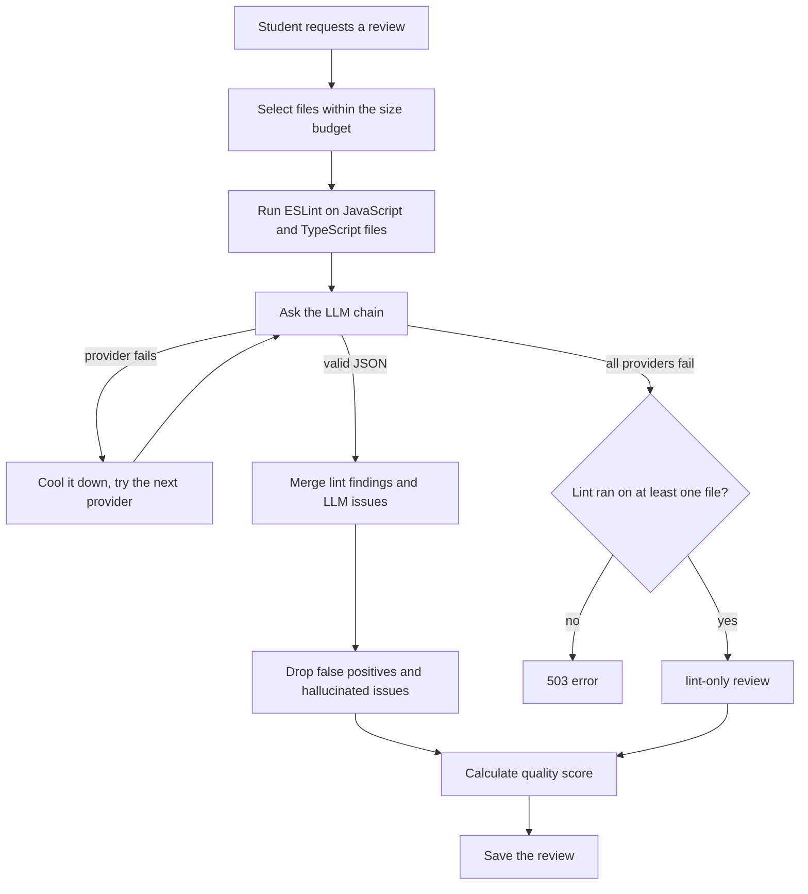

# AI Code Review API

A REST API where students submit their code (pasted, or imported from a public GitHub repository) and receive an automated review that combines a **linter** with an **LLM**. Teachers get a separate read-only view to follow every student's quality score, compare students and track progress over time.

Built with Node.js, Express 5, TypeScript and MongoDB.

---

## Table of contents

- [AI Code Review API](#ai-code-review-api)
  - [Table of contents](#table-of-contents)
  - [Features](#features)
  - [How a review works](#how-a-review-works)
  - [Tech stack](#tech-stack)
  - [Project structure](#project-structure)
  - [Getting started](#getting-started)
    - [Prerequisites](#prerequisites)
    - [Installation](#installation)
    - [Creating a teacher](#creating-a-teacher)
  - [Environment variables](#environment-variables)
  - [Scripts](#scripts)
  - [API reference](#api-reference)
    - [Auth](#auth)
    - [Projects 🔒](#projects-)
    - [Reviews 🔒](#reviews-)
    - [Teacher 🔒 (teacher role only)](#teacher--teacher-role-only)
    - [Other](#other)
    - [Examples](#examples)
  - [Response format](#response-format)
  - [Authentication](#authentication)
  - [Roles and access rules](#roles-and-access-rules)
  - [Security](#security)
  - [Limits](#limits)
  - [Testing](#testing)
  - [Deployment](#deployment)
  - [Known limitations and roadmap](#known-limitations-and-roadmap)
  - [License](#license)

---

## Features

**Students**
- Register, log in, refresh the session, reset a forgotten password, or sign in with Google
- Create a project by pasting code, or import a public GitHub repository
- Run an AI code review on any of their projects and re-run it as the code improves
- See issues by severity, each with an explanation and a suggested fix
- Follow the quality score over time, with a personal dashboard summary

**Teachers**
- Read-only access to every student's projects and reviews
- Class overview: totals, average score, issue totals, score distribution
- Searchable, sortable student list with per-student statistics
- Student detail with project list and full score history
- Side-by-side comparison of 2 to 10 students

**Platform**
- Hybrid review: lint findings grounded and explained by an LLM
- Automatic LLM provider fallback with per-provider cooldowns
- Graceful degradation: a lint-only report when every AI provider is down
- JWT access tokens, rotating refresh tokens, role-based access control
- Rate limiting, request validation, centralized error handling

---

## How a review works



1. **File selection.** Files are added in order until a budget of 40,000 characters is reached. Files that do not fit are listed in `filesSkipped`.
2. **Lint.** Every JavaScript and TypeScript file is checked with ESLint first. The code is only parsed, never executed. Findings get our own severity (for example `no-undef` is high, `prefer-const` is low, anything else is medium).
3. **LLM.** The model receives the numbered code and the lint findings. It validates and explains each finding (it can mark a false positive) and adds new issues the linter cannot see, such as security problems. The model must answer with one JSON object, which is parsed and validated item by item, with one retry when the JSON is unusable. The system prompt tells the model that the code is data and that instructions inside it must be ignored.
4. **Fallback.** Providers are tried in a fixed order: Gemini, Groq, Cloudflare Workers AI. A provider without a key is skipped. A failing provider is put on cooldown (10 minutes after a rate limit, 1 minute after a server error, timeout or bad response, 60 minutes after an authentication error) so later reviews do not wait for it again.
5. **Merge and validate.** Lint findings the model marks as false positives are removed. Issues invented by the model are dropped: the file must exist and the line must be inside the file.
6. **Score.** `100 - penalties`, never below 0. A high issue costs 10 points, a medium 4, a low 1.

**Review modes**

| Mode | Meaning |
|---|---|
| `ai+lint` | The LLM answered and at least one file was linted |
| `ai-only` | The LLM answered, but no file had a linter (for example Python). `unlintedLanguages` lists them |
| `lint-only` | Every AI provider failed. The report contains lint findings only |

Every issue has a `source`: `lint`, `llm` or `lint+llm`.

The linter layer is a plugin system. To support a new language, write one `Linter` implementation and register it in `lint.registry.ts`. Nothing else changes.

---

## Tech stack

| Area | Technology |
|---|---|
| Runtime and language | Node.js, TypeScript 6 |
| Framework | Express 5 |
| Database | MongoDB with Mongoose 9 |
| Validation | Zod 4 |
| Authentication | JWT, bcrypt, rotating refresh tokens in HTTP-only cookies, Google ID token sign-in (`google-auth-library`) |
| Static analysis | ESLint with `@eslint/js` and `typescript-eslint` |
| Security middleware | Helmet, CORS, `express-rate-limit` |
| File upload | Multer (memory storage), images hosted on ImgBB |
| Email | Nodemailer over SMTP |
| LLM providers | Google Gemini, Groq, Cloudflare Workers AI (all through one OpenAI-compatible client using `fetch`, no SDKs) |
| Dev tooling | `tsx` for watch mode, `tsc` for builds |

---

## Project structure

```
src/
├── config/          environment validation, database connection
├── controllers/     thin request handlers
├── middlewares/     auth (protect, restrictTo), validation, upload,
│                    rate limiting, error handling
├── models/          User, Project, Review
├── routes/          auth, projects, reviews, teacher
├── scripts/         development helpers (LLM test, lint test, model list)
├── services/
│   ├── lint/        language detection, Linter interface, ESLint, registry
│   ├── llm/         provider client and the fallback manager
│   ├── review/      review pipeline and prompt building
│   ├── teacher/     teacher aggregations
│   ├── auth.service.ts, email.service.ts, google.service.ts, imgbb.service.ts
│   ├── github-import.service.ts
│   ├── project.service.ts
│   └── student-stats.service.ts
├── types/           Express type extensions
├── utils/           ApiError, asyncHandler, cookies, token helpers
├── validators/      Zod schemas
├── app.ts           Express app (no listen)
└── server.ts        database connect, listen, graceful shutdown
```

Controllers stay thin. Business rules and database access live in services, and every service receives an `actor` (`id` and `role`), so access rules are enforced in one place.

---

## Getting started

### Prerequisites

- Node.js (a current LTS release) and npm
- A MongoDB database (a free MongoDB Atlas cluster works)
- An SMTP account for password reset emails (Mailtrap works for development)
- An ImgBB API key and a Google OAuth client ID (both are required at startup)
- At least one LLM provider key is recommended. Without any key, reviews fall back to lint-only

### Installation

```bash
git clone <your-repository-url>
cd ai-code-review-app-backend
npm install
cp .env.example .env     # then fill in the values
npm run dev
```

When everything is ready the console shows:

```
✅ MongoDB connected (db: ai-code-review)
🚀 Server running on http://localhost:5000
```

Check the server with `GET http://localhost:5000/health`.

> If `npm install` prints an install-scripts warning for `bcrypt`, verify that it works with `node -e "require('bcrypt').hash('x',10).then(h=>console.log(h.length))"` (prints `60`). If it fails, run `npm install-scripts approve bcrypt` and `npm rebuild bcrypt`.

### Creating a teacher

Every new account is a student, whatever the client sends. To create a teacher, change the user's `role` to `teacher` in the database (for example in MongoDB Atlas) and log in again, because the role is stored inside the access token.

---

## Environment variables

Invalid or missing required values stop the server at startup with a clear message.

| Variable | Required | Description |
|---|---|---|
| `NODE_ENV` | no | `development` (default), `production` or `test` |
| `PORT` | no | Server port, default `5000` |
| `MONGODB_URI` | yes | MongoDB connection string. Put the database name in the URI |
| `CLIENT_URL` | no | The only allowed CORS origin, default `http://localhost:5173` |
| `JWT_ACCESS_SECRET` | yes | At least 32 characters |
| `JWT_REFRESH_SECRET` | yes | At least 32 characters, different from the access secret |
| `JWT_ACCESS_EXPIRES_IN` | no | Format `15m`, `12h`, `7d`. Default `15m` |
| `JWT_REFRESH_EXPIRES_IN` | no | Default `7d`. The cookie lifetime is derived from it |
| `IMGBB_API_KEY` | yes | Profile image hosting |
| `SMTP_HOST`, `SMTP_PORT`, `SMTP_USER`, `SMTP_PASS` | yes | Mail server for password reset (`SMTP_PORT` defaults to `2525`) |
| `EMAIL_FROM` | yes | Sender, for example `"AI Code Review <no-reply@example.com>"` |
| `GOOGLE_CLIENT_ID` | yes | Google sign-in. The client secret is not needed |
| `GEMINI_API_KEY`, `GEMINI_MODEL` | no | Provider 1. Default model `gemini-3.5-flash-lite` |
| `GROQ_API_KEY`, `GROQ_MODEL` | no | Provider 2. Default model `openai/gpt-oss-120b` |
| `CLOUDFLARE_ACCOUNT_ID`, `CLOUDFLARE_API_TOKEN`, `CLOUDFLARE_MODEL` | no | Provider 3. Needs both the account id and the token |
| `GITHUB_MODELS_TOKEN`, `GITHUB_MODEL` | no | Reserved. The GitHub Models provider is currently disabled in `llm.manager.ts`, so leave the token empty |
| `GITHUB_TOKEN` | no | Raises the GitHub API limit from 60 to 5000 requests per hour when importing public repositories. Needs no scopes |

Notes:
- Free model names are retired often. Run `npx tsx src/scripts/list-models.ts` to see the models a key can use, and change `*_MODEL` in `.env` (no code change needed).
- `GITHUB_TOKEN` (repository import) and `GITHUB_MODELS_TOKEN` (AI provider) are different credentials. Never give `GITHUB_TOKEN` access to private repositories, or any student could import them.
- Never commit `.env`. Keep `.env.example` up to date instead.
- `tsx watch` does not reload on `.env` changes. Restart the server after editing it.

---

## Scripts

| Command | Description |
|---|---|
| `npm run dev` | Start with auto-reload (`tsx watch`) |
| `npm run typecheck` | Type-check without emitting files |
| `npm run build` | Compile to `dist/` |
| `npm start` | Run the compiled server (`node dist/server.js`) |
| `npx tsx src/scripts/list-models.ts` | List the models available to each configured provider |
| `npx tsx src/scripts/llm-test.ts` | Send one prompt through the provider chain |
| `npx tsx src/scripts/lint-test.ts` | Run the linter on sample snippets |

---

## API reference

All routes are prefixed with `/api`. Routes marked 🔒 need `Authorization: Bearer <accessToken>`.

### Auth

| Method | Route | Description |
|---|---|---|
| POST | `/auth/register` | Create an account (`multipart/form-data`: `fullName`, `email`, `password`, optional `image`) |
| POST | `/auth/login` | Log in. Returns the user and an access token, and sets the refresh cookie |
| POST | `/auth/refresh` | New access token from the refresh cookie (the old refresh token is rotated) |
| POST | `/auth/logout` | Revoke the current refresh token and clear the cookie |
| GET | `/auth/me` 🔒 | The current user |
| POST | `/auth/forgot-password` | Email a reset link. The response is the same whether or not the email exists |
| POST | `/auth/reset-password` | Set a new password with `{ token, password }` |
| POST | `/auth/google` | Sign in with a Google `idToken` |

### Projects 🔒

| Method | Route | Description |
|---|---|---|
| POST | `/projects` | Create a project from pasted files |
| POST | `/projects/import-github` | Import a public GitHub repository |
| GET | `/projects` | List projects (students: own, teachers: all). Query: `page`, `limit` |
| GET | `/projects/stats` | Dashboard summary for the logged-in user |
| GET | `/projects/:id` | Project with its files |
| PATCH | `/projects/:id` | Update title, description or files (owner only) |
| DELETE | `/projects/:id` | Delete the project and its reviews (owner only) |
| POST | `/projects/:id/reviews` | Run a review (owner only) |
| GET | `/projects/:id/reviews` | Review history, newest first, without the issues array |

### Reviews 🔒

| Method | Route | Description |
|---|---|---|
| GET | `/reviews/:id` | Full review with every issue |

### Teacher 🔒 (teacher role only)

| Method | Route | Description |
|---|---|---|
| GET | `/teacher/overview` | Totals, average score, issue totals, score distribution |
| GET | `/teacher/students` | Student list. Query: `page`, `limit`, `sort`, `order`, `search` |
| GET | `/teacher/students/:id` | One student: summary, projects, full score history |
| GET | `/teacher/compare?ids=a,b,c` | Compare 2 to 10 students side by side |

`sort` accepts `latestScore`, `avgScore`, `reviewCount`, `projectCount` or `name`. Students without reviews are always listed last. `search` matches name or email.

### Other

| Method | Route | Description |
|---|---|---|
| GET | `/health` | Health check (outside `/api`) |

### Examples

Create a project:

```http
POST /api/projects
Content-Type: application/json
Authorization: Bearer <accessToken>

{
  "title": "Buggy demo",
  "files": [
    { "path": "app.js", "content": "var x = 1;\nfunction f() { return y }\nconsole.log(f())" }
  ]
}
```

Import a repository:

```http
POST /api/projects/import-github
Content-Type: application/json
Authorization: Bearer <accessToken>

{
  "title": "Express source",
  "repoUrl": "https://github.com/expressjs/express"
}
```

A review response (shortened):

```json
{
  "success": true,
  "message": "Review completed",
  "data": {
    "review": {
      "reviewMode": "ai+lint",
      "provider": "gemini",
      "model": "gemini-3.5-flash-lite",
      "qualityScore": 56,
      "issueCounts": { "high": 4, "medium": 1, "low": 0 },
      "filesReviewed": 1,
      "filesSkipped": [],
      "unlintedLanguages": [],
      "summary": "…",
      "issues": [
        {
          "file": "app.js",
          "line": 2,
          "severity": "high",
          "category": "bug",
          "message": "'y' is not defined.",
          "rule": "no-undef",
          "explanation": "…",
          "suggestedFix": "…",
          "source": "lint+llm"
        }
      ]
    }
  }
}
```

---

## Response format

Every response has a `success` flag.

```json
{ "success": true, "data": { } }
```

```json
{
  "success": false,
  "message": "Validation failed",
  "details": [{ "field": "body.repoUrl", "message": "Repository URL is required" }]
}
```

| Status | Meaning |
|---|---|
| 400 | Validation error or malformed request |
| 401 | Missing, invalid or expired token, or wrong credentials |
| 403 | Authenticated but not allowed (for example a student on a teacher route) |
| 404 | Not found, or not visible to this user |
| 409 | Duplicate value (for example an email already registered) |
| 413 | Request body too large |
| 429 | Rate limit reached |
| 502 | An upstream service (GitHub) failed |
| 503 | No AI provider is available and no linter exists for the submitted languages |

Stack traces are only included when `NODE_ENV=development`.

---

## Authentication

- **Access token:** a JWT sent in the `Authorization: Bearer` header. It lives for 15 minutes and should be kept in memory on the client.
- **Refresh token:** a JWT in an HTTP-only cookie named `refreshToken`, limited to the path `/api/auth`, valid for 7 days. In production the cookie is `secure` and `sameSite=none`.
- **Rotation:** every refresh invalidates the used refresh token and issues a new pair. If a refresh token that is not on record is presented (possible theft), all sessions of that user are revoked.
- **Storage:** only the SHA-256 hash of each refresh token is stored, with a maximum of 5 active devices per user.
- **Passwords:** 8 to 72 characters with at least one letter and one number, hashed with bcrypt (12 rounds). Changing the password revokes all refresh tokens and invalidates access tokens issued before the change.
- **Password reset:** a random one-time token, emailed as a link to the client. Only its hash is stored, and it expires after 15 minutes.
- **Google sign-in:** the client sends a Google `idToken`, the server verifies it, links the account when the verified email already exists, and then issues its own tokens. Google users are always students.
- **Roles:** the `role` field is never accepted from the client.

A frontend must send requests with credentials (`credentials: "include"`) and should run only one refresh request at a time, because parallel refreshes can trigger the reuse detection and log the user out.

---

## Roles and access rules

| Action | Student | Teacher |
|---|---|---|
| Create, edit, delete own projects | ✅ | ✅ |
| Run a review on own project | ✅ | ✅ |
| Run a review on someone else's project | ❌ 404 | ❌ 403 |
| Read own projects and reviews | ✅ | ✅ |
| Read other students' projects and reviews | ❌ 404 | ✅ |
| Edit or delete someone else's project | ❌ 404 | ❌ 403 |
| Use `/api/teacher/*` | ❌ 403 | ✅ |

Students receive **404** instead of 403 for other people's data, so they cannot learn whether a project or review exists.

---

## Security

- Short-lived access tokens, rotating refresh tokens with reuse detection, token hashes in the database
- `protect` and `restrictTo(...)` middleware, applied once per router
- Same error message for an unknown email and a wrong password, and the same response from forgot-password for any email
- Zod validation for request bodies and query parameters
- Helmet headers and a single-origin CORS policy with credentials
- Rate limiting, body size limit, upload type and size checks (JPEG, PNG, WebP, 2 MB)
- Submitted code is only parsed by the linter and sent to the LLM as data, never executed
- Error output without stack traces in production
- Graceful shutdown on `SIGINT` and `SIGTERM`, process exit on uncaught exceptions
- GitHub import is limited to public repositories

---

## Limits

**Rate limits** (in memory, per IP unless noted)

| Scope | Limit |
|---|---|
| Whole API | 300 requests per 15 minutes |
| Login and Google sign-in | 10 failed attempts per 15 minutes |
| Register, forgot and reset password | 10 per hour |
| Run review | 30 per hour, per user |
| Import GitHub | 15 per hour, per user |

**Projects, reviews and imports**

| Item | Limit |
|---|---|
| Files per project | 20 |
| Size of one file | 100,000 characters |
| Characters sent to a review | 40,000 in total |
| Request body | 3 MB |
| GitHub import, total size | 500 KB |
| GitHub import, ignored | `node_modules`, `dist`, `build`, `out`, `coverage`, `vendor`, `target`, `bin`, `obj`, `__pycache__`, `.git`, `.next`, `.nuxt`, `venv`, `.d.ts` and `.min.` files, unsupported extensions |
| LLM request timeout | 30 seconds per provider |
| Reset token lifetime | 15 minutes |

Recognized languages: JavaScript, TypeScript, Python, Java, Go, Ruby, PHP, C, C++, C#, Rust. Only JavaScript and TypeScript have a linter today. Other languages are reviewed by the AI only.

---

## Testing

The API was verified end to end with a Postman collection. The verified scenarios include:

- Registration, login, refresh, logout, password reset and Google sign-in
- Token protection: every private route returns 401 without a token, and the open routes stay open
- Pasted and imported projects, review runs, score history and review detail
- Provider fallback, and the review modes `ai+lint` and `ai-only`
- Access rules between two students and between a student and a teacher
- Teacher overview, student list, student detail and comparison
- Student dashboard statistics, including a brand new account with no data
- Error cases: unknown repository, non-GitHub URL, empty fields, invalid ids, expired token

Tips for manual testing:
- Access tokens expire after 15 minutes. Log in again when a request returns `401 Invalid or expired token`.
- A project id or review id variable must point to something the logged-in user can see, otherwise the API answers 404.
- The role is stored inside the token. After changing a role in the database, log in again.

---

## Deployment

Planned setup: the API on a Node host (Render or Railway), MongoDB Atlas for the database, and the frontend on Vercel.

1. Set every variable from [Environment variables](#environment-variables) in the host dashboard. Use `NODE_ENV=production`, new random JWT secrets and a new database password.
2. Build with `npm install && npm run build` and start with `npm start`. Make sure the TypeScript dev dependencies are installed at build time.
3. Set the health check path to `/health`.
4. Set `CLIENT_URL` to the live frontend URL (no trailing slash), and add the same URL to the Google OAuth client's authorized origins.
5. The refresh cookie is `secure` and `sameSite=none` in production. If a browser blocks third-party cookies, serve the frontend and the API from subdomains of one domain or proxy the API through the frontend host.
6. A review is a synchronous request that can take 10 to 40 seconds. Check the host's request timeout.
7. Re-check the LLM model names (`list-models.ts`) before going live.

---

## Known limitations and roadmap

**Current limitations**
- A review looks at the first 40,000 characters of code. Larger projects and large imported repositories are only partly reviewed, and the skipped files are listed in `filesSkipped`
- Only public GitHub repositories can be imported, only the default branch, and only the first 20 supported files
- Only JavaScript and TypeScript are linted
- Email verification is not implemented (`isEmailVerified` is only set for Google users)
- Rate limits and provider cooldowns live in memory, which is fine for a single server instance
- The teacher student list is sorted and paginated in memory after aggregation, which suits a class-sized group
- Reviews run inside the request instead of in a background job

**Planned**
- Student dashboard and teacher dashboard (frontend)
- Private repository import (student token or GitHub OAuth)
- More linters (for example Ruff for Python) behind the existing `Linter` interface
- Background review jobs with polling
- Class or batch grouping for teachers
- Shared store for rate limits when running several server instances


---

## License

Released under the [MIT License](LICENSE).